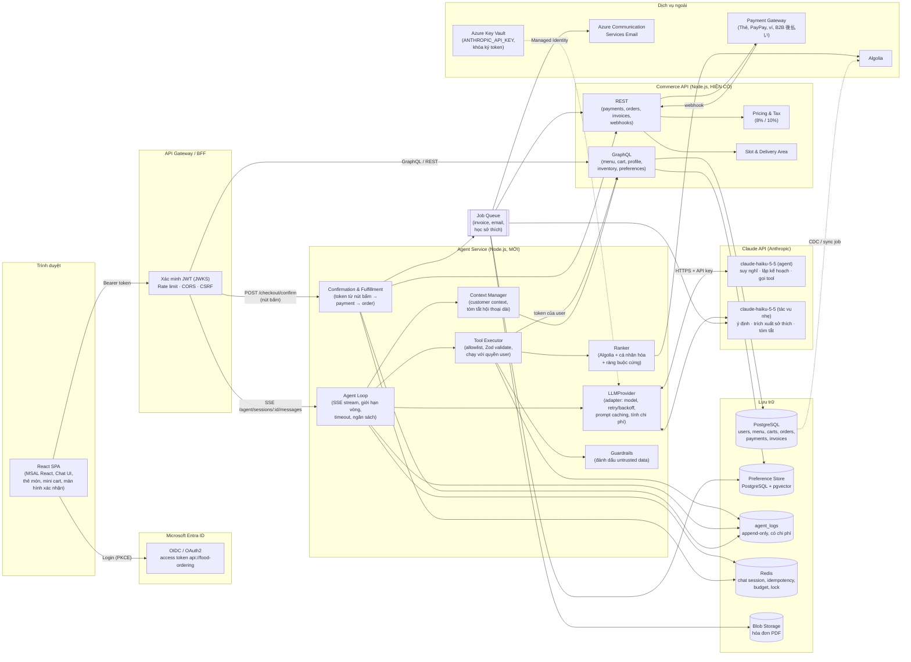
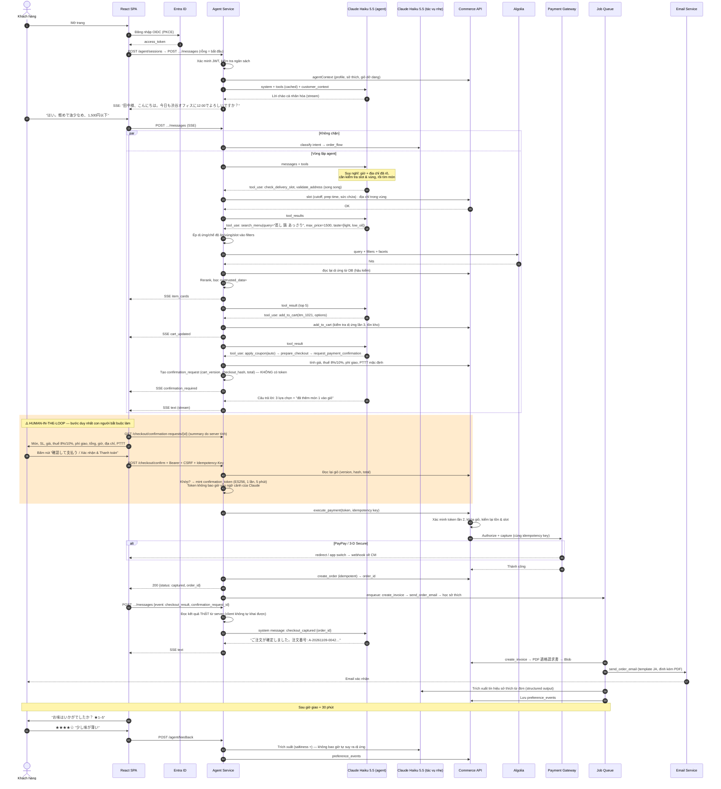

# 2. Kiến trúc tổng thể · 3. Vòng lặp Agent · 4. Sequence diagram

## 2.1 Sơ đồ kiến trúc



### Vai trò từng thành phần

| Thành phần | Vai trò | Mới / Tái sử dụng |
|---|---|---|
| React SPA | Chat UI, thẻ gợi ý, mini cart, màn hình xác nhận; MSAL React đăng nhập Entra ID. Không giữ API key Claude. | Tái sử dụng app, thêm module chat |
| API Gateway / BFF | Xác minh access token Entra (issuer, audience, chữ ký, `exp`, scope), rate limit, định tuyến | Tái sử dụng (thêm route) |
| **Agent Service** | Agent loop, LLMProvider, tool executor, context manager, ranker, guardrails, confirmation & fulfillment, SSE | **Mới** |
| **Claude API** | `claude-haiku-5-5` — model nhẹ, rẻ nhất — cho cả bộ não agent và tác vụ nhẹ chạy song song/nền. Có thể chuyển phần agent sang `claude-sonnet-5-5` bằng cấu hình nếu cần | **Mới** |
| Commerce API | Nguồn sự thật cho menu, tồn kho, giỏ, giá, thuế, slot, đơn hàng, thanh toán, hóa đơn | Tái sử dụng, bổ sung endpoint |
| Preference Store | Hồ sơ khẩu vị có cấu trúc + event log + embedding (pgvector) | **Mới** (trên PostgreSQL sẵn có) |
| Algolia | Full-text + facet + filter | Tái sử dụng, thêm thuộc tính |
| Job Queue | PDF hóa đơn, email, trích xuất sở thích (Haiku), hỏi đánh giá sau giao | Mới (BullMQ trên Redis hoặc Azure Service Bus) |
| Key Vault | `ANTHROPIC_API_KEY`, khóa ký `confirmation_token`, khóa PSP | Tái sử dụng/mới |

### Quyết định kiến trúc chính

1. **Agent Service tách khỏi Commerce API**: deploy/rollback độc lập, giới hạn blast radius; luồng mua truyền thống vẫn chạy song song và là phương án dự phòng khi Claude không khả dụng.
2. **Chỉ backend gọi Claude**: `ANTHROPIC_API_KEY` đọc từ biến môi trường (Key Vault reference qua Managed Identity ở production). Mọi lời gọi đi qua `LLMProvider` — một chỗ duy nhất cho model, effort, timeout, retry/backoff, prompt caching và tính chi phí.
3. **Agent gọi Commerce API với ngữ cảnh người dùng**: chuyển tiếp access token của người dùng (hoặc On-Behalf-Of nếu khác audience). Commerce API phân quyền như với request từ UI → Claude **không bao giờ có nhiều quyền hơn người dùng**.
4. **Thanh toán đi đường riêng**: `POST /checkout/confirm` (từ nút UI) → token → `execute_payment` → `create_order`. Claude chỉ nhận *kết quả* qua system message của nền tảng.
5. **Hậu xử lý bất đồng bộ**: hóa đơn, email, học sở thích chạy trong queue có retry; lỗi mail không làm hỏng đơn hàng.

---

## 3. Vòng lặp Agent — Claude suy nghĩ, backend thực thi

```mermaid
flowchart TD
  START([Tin nhắn của khách<br/>hoặc sự kiện nền tảng]) --> GUARDS{Ngân sách hôm nay<br/>còn không?}
  GUARDS -- hết --> FALLBACK[Thông báo lịch sự +<br/>link màn hình đặt món thường]
  GUARDS -- còn --> CTXM[Context Manager:<br/>• tóm tắt nếu hội thoại quá dài (Haiku)<br/>• thêm turn_context, customer_context]
  CTXM --> INTENT[[Haiku: phân loại ý định<br/>song song, không chặn]]
  CTXM --> THINK

  subgraph LOOP["Lặp tối đa 12 vòng · 30 tool call · 90 giây / lượt"]
    THINK["① Claude Haiku 5.5 suy nghĩ & lập kế hoạch<br/>đọc tin nhắn, ngữ cảnh, sở thích → thiếu gì? bước nào? thứ tự?"]
    THINK --> DECIDE{"② Claude trả về gì?"}
    DECIDE -- "tool_use<br/>(1 hoặc nhiều tool)" --> EXEC
    EXEC["③ Backend thực thi<br/>allowlist → Zod validate → quyền của user<br/>→ ép ràng buộc cứng → Algolia / DB / Commerce API<br/>→ đánh dấu untrusted data → ghi audit"]
    EXEC --> OBS["④ Kết quả tool (JSON, ok / error code)<br/>gửi lại cho Claude trong 1 message"]
    OBS --> THINK
  end

  DECIDE -- "end_turn (câu trả lời)" --> ANSWER["⑤ Câu trả lời tự nhiên<br/>stream từng token về khung chat (SSE)"]
  DECIDE -- "refusal / lỗi / quá tải<br/>(sau retry có backoff)" --> FALLBACK
  ANSWER --> SAVE[(Lưu lịch sử append-only,<br/>token, chi phí, tóm tắt suy nghĩ)]

  EXEC -. "request_payment_confirmation" .-> SCREEN[/"Màn hình xác nhận<br/>(SSE confirmation_required)"/]
  SCREEN -. "👤 KHÁCH BẤM NÚT<br/>(ngoài vòng lặp của Claude)" .-> PAY["Backend: token → execute_payment<br/>→ create_order → queue: invoice, email"]
  PAY -. "system message:<br/>checkout_captured / failed" .-> START
```

**Cách Claude tự lập lại kế hoạch** — ví dụ trong bước ④:

| Kết quả tool | Claude làm gì tiếp (không bắt khách làm lại) |
|---|---|
| `add_to_cart` → `ITEM_SOLD_OUT` | `check_inventory` các món cùng quán/cùng tag → `search_menu` món tương đương → đề xuất 1–2 món, giữ nguyên giờ + địa chỉ |
| `check_delivery_slot` → `FULL` + `alternatives` | Đề xuất 2–3 khung gần nhất, giữ món đã chọn |
| `prepare_checkout` → tổng vượt ngân sách khách nói | Bỏ đồ uống / đổi size / thay món phụ, gọi `update_cart`, giải thích ngắn |
| `validate_address` → `OUT_OF_SERVICE_AREA` | Đọc lại địa chỉ đã chuẩn hóa, gợi ý địa chỉ đã lưu trong vùng giao |
| `update_cart` → `CART_VERSION_CONFLICT` (khách vừa sửa trên UI) | `get_cart` rồi thực hiện lại thao tác trên phiên bản mới |

**Tham số gọi Claude** (chi tiết ở [10-code-skeleton.md](10-code-skeleton.md)): `claude-haiku-5-5`, adaptive thinking với `display: "summarized"` (tóm tắt suy nghĩ để audit, không hiển thị cho khách), `effort: "medium"` (giữ độ tin cậy khi gọi nhiều tool trên model nhỏ; thử `low` bằng evals), prompt caching cho system prompt + tools + phần đầu hội thoại, `tool_choice` mặc định `auto`.

---

## 4. Sequence diagram — luồng đặt món end-to-end



### Điểm then chốt

- **Khung cam** là điểm human-in-the-loop. Token sinh **sau** cú bấm nút và không xuất hiện trong bất kỳ ngữ cảnh nào Claude đọc được.
- **Kiểm tra độc lập ở Commerce API**: dù Agent Service bị chiếm quyền, Commerce API vẫn xác minh chữ ký token (khóa trong Key Vault).
- **Báo kết quả cho Claude an toàn**: trình duyệt chỉ gửi `confirmation_request_id`; Agent Service đọc kết quả thật phía server và đưa vào hội thoại bằng **system message** của nền tảng — khách không thể giả mạo "đã thanh toán".
- **Idempotency**: key do FE sinh một lần khi mở màn hình xác nhận; bấm 2 lần / mạng chập chờn / retry đều trả cùng kết quả, không trừ tiền 2 lần, không tạo 2 đơn.
