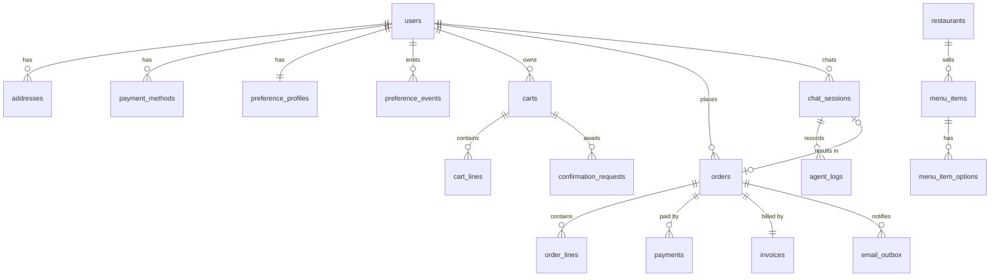

# 7. Data model

PostgreSQL 16 + pgvector. Tiền tệ JPY lưu `INTEGER` (không số lẻ). Thời gian lưu `TIMESTAMPTZ`, hiển thị theo `Asia/Tokyo`.
DDL đầy đủ: [backend/db/migrations/](../backend/db/migrations/) — `001_init.sql` (schema chính) và `002_pgvector.sql` (cột embedding, chỉ áp dụng khi Postgres có extension pgvector). Chạy bằng `npm run db:migrate`.



## 7.1 Bảng chính

### `users`
| Cột | Kiểu | Ghi chú |
|---|---|---|
| user_id | UUID PK | |
| entra_oid | UUID UNIQUE | claim `oid` của Entra ID (định danh ổn định) |
| entra_tid | UUID | tenant |
| display_name, family_name, given_name | TEXT | |
| email | CITEXT | |
| locale | TEXT | `ja-JP` (mặc định) / `en` |
| personalization_consent | BOOLEAN | đồng ý dùng lịch sử để cá nhân hóa |
| sensitive_data_consent_at | TIMESTAMPTZ NULL | đồng ý lưu dị ứng/chế độ ăn (要配慮個人情報) |
| company_id | UUID NULL | nếu khách doanh nghiệp (trả sau) |
| created_at, updated_at | TIMESTAMPTZ | |

### `addresses`
`address_id`, `user_id`, `label (home|office|other)`, `postal_code CHAR(8)` (`150-0002`), `prefecture`, `city`, `street`, `building`, `recipient_name`, `phone`, `zone_code`, `geo POINT`, `is_default`, `deleted_at`.

### `payment_methods`
`payment_method_id`, `user_id`, `type (card|paypay|rakuten_pay|d_barai|au_pay|corporate_invoice)`, `psp_token` (token của PSP — **không lưu số thẻ**), `brand`, `last4`, `exp_month`, `exp_year`, `is_default`, `company_id NULL`.

### `restaurants`
`restaurant_id`, `name_ja`, `name_en`, `qualified_invoice_reg_no CHAR(14)` (`T` + 13 số, CHECK `^T\d{13}$`), `min_prep_minutes`, `opening_hours JSONB`, `zone_codes TEXT[]`, `is_active`.

### `menu_items`
| Cột | Kiểu | Ghi chú |
|---|---|---|
| item_id | TEXT PK | |
| restaurant_id | FK | |
| name_ja, name_en, description_ja, description_en | TEXT | mô tả được làm sạch khi index, vẫn coi là untrusted |
| price_incl_tax | INTEGER | giá đã gồm thuế (総額表示) |
| tax_category | TEXT | `reduced_8` / `standard_10` |
| allergens | TEXT[] | mã trong 28 mục |
| allergen_data_complete | BOOLEAN | đã khai báo đủ 28 mục |
| may_contain | TEXT[] | コンタミ (nhiễm chéo) — hiển thị cảnh báo |
| dietary_tags | TEXT[] | `vegetarian`, `vegan`, `halal`, `low_carb`, `gluten_free` |
| taste_tags | TEXT[] | `light`, `low_oil`, `spicy`, … |
| taste_vector | JSONB | `{spicy:0.1, oily:0.2, saltiness:0.5…}` |
| category, cuisine, serving_temp | TEXT | |
| calories | INTEGER | |
| embedding | VECTOR(1024) | |
| daily_stock | INTEGER NULL | NULL = không giới hạn |
| is_sold_out | BOOLEAN | |
| available_from, available_to | TIME | |
| updated_at | TIMESTAMPTZ | trigger đồng bộ Algolia |

### `menu_item_options`
`option_group_id`, `item_id`, `name_ja/en`, `required`, `options JSONB` (`[{option_id, name_ja, name_en, price_delta, allergens_added[]}]`).
> Option có thể **thêm** chất gây dị ứng (ví dụ topping tôm) → được kiểm tra khi `add_to_cart` / `update_cart`.

### `delivery_slots`
`zone_code`, `slot_start TIMESTAMPTZ`, `capacity`, `reserved`, `order_cutoff TIMESTAMPTZ`. Giữ chỗ: `slot_holds(cart_id, slot_start, expires_at)`.

### `preference_profiles`
| Cột | Kiểu | Ghi chú |
|---|---|---|
| user_id | PK/FK | |
| allergens | TEXT[] | ràng buộc cứng |
| dietary | TEXT[] | ràng buộc cứng |
| soft | JSONB | liked/disliked items & restaurants, taste, cuisines, price_range (đã suy giảm) |
| taste_embedding | VECTOR(1024) | |
| version | INTEGER | |
| recomputed_at | TIMESTAMPTZ | |

### `preference_events` (append-only)
`event_id`, `user_id`, `kind` (`order_completed|rating|removed_from_cart|explicit_like|explicit_dislike|allergen_add|allergen_remove|dietary_change|taste_note|user_edit|user_delete`), `subject_type (item|restaurant|taste|cuisine|allergen)`, `subject_id`, `value NUMERIC`, `source (order|chat|settings|feedback|system)`, `user_quote TEXT NULL`, `half_life_days`, `status (applied|pending_user_confirmation|rejected)`, `created_at`.

### `carts`
| Cột | Kiểu | Ghi chú |
|---|---|---|
| cart_id | UUID PK | |
| user_id | FK | partial UNIQUE `(user_id) WHERE status='active'` — 1 giỏ đang hoạt động |
| restaurant_id | FK NULL | quy tắc 1 quán / đơn |
| status | TEXT | `active`, `checked_out`, `abandoned`, `expired` |
| version | INTEGER | **tăng mỗi lần thay đổi** (lines, options, slot, address, coupon, PTTT) |
| delivery_date, slot_start, address_id | | |
| payment_method_id, coupon_code, points_used | | |
| created_by | TEXT | `agent` / `ui` |
| last_activity_at | TIMESTAMPTZ | phục vụ khôi phục giỏ bỏ dở |

### `cart_lines`
`cart_line_id`, `cart_id`, `item_id`, `quantity`, `options JSONB`, `unit_price_incl_tax` (snapshot), `tax_category`, `note`, `added_by (agent|user)`.

### `confirmation_requests`
`confirmation_request_id`, `user_id`, `cart_id`, `cart_version`, `checkout_hash`, `total`, `summary JSONB` (snapshot hiển thị), `status (AWAITING_USER|TOKEN_ISSUED|CONSUMED|STALE|EXPIRED)`, `token_jti`, `expires_at`, `created_at`.

### `orders`
| Cột | Kiểu | Ghi chú |
|---|---|---|
| order_id | TEXT PK | `A-YYYYMMDD-NNNN` |
| user_id, cart_id, restaurant_id | FK | |
| idempotency_key | TEXT UNIQUE | |
| status | TEXT | `pending_payment`, `paid`, `preparing`, `delivering`, `delivered`, `cancelled`, `refunded` |
| delivery_slot_start, address_snapshot JSONB | | địa chỉ chụp lại tại thời điểm đặt |
| subtotal_8, subtotal_10 | INTEGER | tổng tiền (đã gồm thuế) theo mức thuế |
| tax_8, tax_10 | INTEGER | thuế theo mức, làm tròn xuống 1 lần/mức |
| discount_total, delivery_fee, points_used, total | INTEGER | |
| placed_via | TEXT | `agent_chat` / `ui` |
| confirmation_request_id | FK | chứng cứ human-in-the-loop |
| created_at, paid_at, delivered_at | | |

`order_lines`: snapshot tên, option, đơn giá, số lượng, `tax_rate`, `allergens` tại thời điểm đặt.

### `payments`
`payment_id`, `order_id`, `user_id`, `method_type`, `psp`, `psp_payment_id`, `idempotency_key UNIQUE`, `amount`, `status (initiated|requires_action|authorized|captured|failed|voided|refunded|unknown)`, `failure_code`, `raw_response JSONB` (đã che), `created_at`, `updated_at`.

### `invoices` (適格請求書)
| Cột | Ghi chú |
|---|---|
| invoice_id, invoice_number (UNIQUE, tuần tự `INV-YYYY-MM-NNNNNN`) | |
| order_id UNIQUE | |
| issuer_name, issuer_reg_no `T\d{13}` | **bắt buộc**: tên và số đăng ký bên phát hành |
| recipient_name | 宛名 (tên người/công ty nhận) |
| transaction_date | **bắt buộc**: ngày giao dịch |
| lines JSONB | **bắt buộc**: nội dung giao dịch, đánh dấu ※ món thuế suất giảm |
| amount_8_incl, amount_10_incl | **bắt buộc**: tổng theo từng mức thuế |
| tax_8, tax_10 | **bắt buộc**: tiền thuế theo từng mức |
| total | |
| pdf_blob_path, pdf_sha256 | |
| issued_at | |
| corrects_invoice_id NULL | 適格返還請求書 / hóa đơn điều chỉnh khi hoàn tiền |

### `chat_sessions`
| Cột | Ghi chú |
|---|---|
| session_id, user_id, locale | |
| status | `active`, `abandoned`, `completed`, `expired` |
| epoch | tăng mỗi lần hội thoại được tóm tắt để bắt đầu lại từ bản tóm tắt |
| summary JSONB | bản tóm tắt mới nhất (Claude Haiku 5.5): giờ, địa chỉ, mong muốn hôm nay, dị ứng trong phiên, giỏ, câu hỏi mở |
| cart_id, order_id | liên kết kết quả phiên |
| main_model, light_model | model đã dùng (để so sánh khi đổi model) |
| total_input_tokens, total_output_tokens, total_cost_usd | chi phí Claude của phiên |
| started_at, last_activity_at | |

Lịch sử tin nhắn đầy đủ của phiên sống trong Redis (24h); bản ghi chi tiết từng lượt nằm ở `agent_logs`.

### `agent_logs` (append-only, audit)
| Cột | Ghi chú |
|---|---|
| log_id BIGSERIAL | |
| session_id, user_id, turn_index | |
| actor | `llm`, `user_chat`, `user_ui`, `system` |
| event_type | `user_message`, `assistant_message` (kèm danh sách tool Claude định gọi), `tool_call`, `platform_event`, `intent` (Haiku), `context_summarized`, `guardrail_block`, `confirmation_issued`, `payment_event`, `error` |
| tool_name, tool_input JSONB, tool_output JSONB (PII che bớt) | |
| cart_version_before, cart_version_after | |
| decision_rationale TEXT | **tóm tắt suy nghĩ của Claude** (adaptive thinking, `display: "summarized"`) cho lượt đó, và match_reasons của kết quả tìm kiếm. Chuỗi suy nghĩ gốc không bao giờ được API trả về |
| model, request_id (Claude), latency_ms | model nào đã trả lời (Haiku mặc định; Sonnet nếu đã chuyển cấu hình) |
| input_tokens, output_tokens, cache_read_tokens, cache_write_tokens, cost_usd | token & chi phí từng lời gọi Claude — cộng dồn ra chi phí theo lượt, theo phiên, theo đơn |
| prev_hash, row_hash | chuỗi băm chống sửa (tamper-evident) |
| created_at | |

Quyền DB: role ứng dụng chỉ có `INSERT, SELECT` trên `agent_logs`, không `UPDATE/DELETE`.

### `idempotency_keys`, `email_outbox`
- `idempotency_keys(user_id, key, request_hash, status, response JSONB, expires_at)` UNIQUE `(user_id, key)`.
- `email_outbox(email_id, order_id, template, locale, to_address, attachment_invoice_id, status, provider_message_id, attempts, dedupe_key UNIQUE)`.

## 7.2 Algolia record (`menu_items_ja`)

```json
{
  "objectID": "itm_1021",
  "name": "鶏むね肉と温野菜の蒸し定食",
  "description": "蒸した鶏むね肉と季節の温野菜…",
  "restaurant_id": "rst_healthy_shibuya",
  "restaurant_name": "ヘルシー食堂 渋谷店",
  "price_incl_tax": 1180,
  "category": "rice", "cuisine": "japanese", "serving_temp": "hot",
  "allergens": ["wheat", "soybean", "chicken"],
  "allergen_data_complete": true,
  "dietary_tags": [],
  "taste_tags": ["light", "low_oil", "high_protein"],
  "calories": 520,
  "delivery_area_codes": ["SHIBUYA-A", "SHIBUYA-B"],
  "serving_from_min": 630,
  "serving_to_min": 840,
  "is_sold_out": false,
  "popularity": 0.82
}
```
- `attributesForFaceting`: `filterOnly(allergens)`, `filterOnly(delivery_area_codes)`, `category`, `cuisine`, `taste_tags`, `dietary_tags`, `is_sold_out`, `allergen_data_complete`, `restaurant_id`.
- Ngôn ngữ: `queryLanguages:["ja"]`, `indexLanguages:["ja"]` (tách từ tiếng Nhật), synonyms (あっさり ⇔ さっぱり ⇔ ヘルシー; 麺 ⇔ うどん/そば/ラーメン).
- **Không index tồn kho / sức chứa theo slot** (thay đổi liên tục): Algolia chỉ lọc theo **giờ phục vụ** (`serving_from_min` / `serving_to_min`, phút kể từ 00:00 JST) và cờ thô `is_sold_out`. Tồn kho thời gian thực được kiểm tra phía server ở `check_inventory`, `add_to_cart` và `execute_payment`.
- `numericAttributesForFiltering`: `price_incl_tax`, `calories`, `serving_from_min`, `serving_to_min`; synonyms tiếng Nhật (あっさり ⇔ さっぱり ⇔ ヘルシー; 麺 ⇔ うどん/そば/ラーメン; 海老 ⇔ えび …).
- Script tạo index + settings + synonyms + dữ liệu mẫu cho dev: [backend/src/search/syncAlgolia.ts](../backend/src/search/syncAlgolia.ts).
