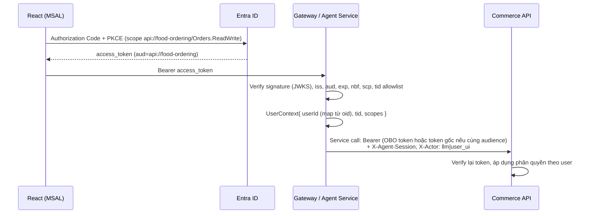

# 8. API

> **Hiện trạng trong repo:** backend là một ứng dụng Node.js duy nhất; frontend dùng **REST + SSE** dưới đây. Các module bán hàng (`backend/src/commerce/*`) được agent gọi trực tiếp. GraphQL ở mục 8.3 là thiết kế cho trường hợp tích hợp với hệ thống GraphQL sẵn có — có thể bọc các module đó khi cần.
>
> Endpoint đã có: `GET /api/auth/config`, `POST /api/auth/demo-login`, `POST /api/agent/sessions`, `POST /api/agent/sessions/:id/messages` (SSE), `POST /api/agent/feedback`, `GET /api/checkout/confirmation-requests/:id`, `POST /api/checkout/confirmation-requests/:id/cancel`, `POST /api/checkout/confirm`, `GET /api/agent/sessions` (lịch sử chat), `GET /api/agent/sessions/:id/transcript`, `GET /api/menu` (menu theo danh mục cho trang chủ), `GET /api/me`, `GET /api/cart`, `GET /api/orders`, `GET /api/orders/:id/invoice`, `GET|DELETE /api/me/preferences`, `GET /healthz`.

## 8.1 Phân chia REST / GraphQL / SSE

| Loại | Dùng cho | Lý do |
|---|---|---|
| **GraphQL** (tái sử dụng Commerce API) | Đọc/ghi dữ liệu "tài nguyên" linh hoạt: menu, chi tiết món, giỏ hàng, hồ sơ, địa chỉ, sở thích, lịch sử đơn | UI và Agent cần lấy đúng các trường mình cần; giỏ hàng/mini cart cập nhật bằng subscription |
| **REST** | Các thao tác **có hậu quả, cần idempotency, webhook, file**: checkout confirm, payment, invoice PDF, webhook PSP, tạo phiên chat | Ngữ nghĩa HTTP rõ ràng (status code, `Idempotency-Key`, cache), dễ audit và rate limit riêng, PSP chỉ hỗ trợ webhook REST |
| **SSE** | Stream câu trả lời của Agent và các sự kiện UI (thẻ món, giỏ, màn hình xác nhận) | Một chiều server→client là đủ (tin nhắn khách gửi bằng POST), hoạt động tốt qua proxy/Azure Front Door, tự reconnect với `Last-Event-ID`. WebSocket chỉ cần nếu sau này có voice/duplex. |

Tất cả endpoint yêu cầu `Authorization: Bearer <Entra access token>` (audience `api://food-ordering`, scope `Orders.ReadWrite`), trừ webhook PSP (xác minh chữ ký PSP).

## 8.2 REST

### Agent

| Method | Path | Mô tả |
|---|---|---|
| POST | `/api/agent/sessions` | Tạo phiên chat. Trả `session_id`, lời chào được stream ở request tiếp theo. Body: `{ "locale": "ja" }` |
| POST | `/api/agent/sessions/{sessionId}/messages` | Gửi tin nhắn, **response là SSE stream** (`Content-Type: text/event-stream`). Body: `{ "text": "...", "client_message_id": "uuid" }`, hoặc sau khi bấm nút thanh toán: `{ "event": { "type": "checkout_result", "confirmation_request_id": "cr_…" } }` — server tự đọc kết quả thật và đưa vào hội thoại dưới dạng system message (client không khai kết quả được) |
| GET | `/api/agent/sessions/{sessionId}/events?after={eventId}` | Reconnect: phát lại sự kiện sau `eventId` |
| POST | `/api/agent/feedback` | Đánh giá sau giao `{ order_id, stars, comment }` → Claude Haiku trích xuất sở thích (202, chạy nền) |
| POST | `/api/agent/sessions/{sessionId}/ui-actions` | Hành động từ UI không phải văn bản (bấm chip gợi ý, "đổi món này", ★ đánh giá) → chuyển thành tin nhắn có cấu trúc cho Agent |
| GET | `/api/agent/sessions/{sessionId}` | Trạng thái phiên + tóm tắt (khôi phục khi quay lại) |

**SSE events**

```
event: text_delta          data: {"text":"田中様、こんにちは。"}
event: tool_status         data: {"tool":"search_menu","status":"running","label_ja":"メニューを検索中…"}
event: item_cards          data: {"items":[{item_id,name,price_incl_tax,image_url,allergens,match_reasons,restaurant}]}
event: quick_replies       data: {"options":[{"id":"slot_1230","label":"12:30"}]}
event: cart_updated        data: {"cart_id":"…","cart_version":3,"lines":[…],"subtotal":1340}
event: confirmation_required data: {"confirmation_request_id":"cr_8f2","expires_at":"…"}
event: confirmation_invalidated data: {"confirmation_request_id":"cr_8f2","reason":"CART_CHANGED"}
event: order_completed     data: {"order_id":"A-20261109-0042"}
event: message_end         data: {"message_id":"…"}
event: handoff_suggested   data: {"reason":"complaint"}                       ← Haiku phát hiện cần người hỗ trợ
event: error               data: {"code":"AGENT_UNAVAILABLE_OVERLOADED","message":"申し訳ございません。ただいま…","fallback_url":"/order"}
                           (code khác: AGENT_TIMEOUT, AGENT_DECLINED, BUDGET_EXCEEDED, SESSION_BUSY)
```

### Checkout & thanh toán (Human-in-the-loop)

| Method | Path | Mô tả |
|---|---|---|
| GET | `/api/checkout/confirmation-requests/{id}` | Summary **do server tính** để render màn hình xác nhận |
| POST | `/api/checkout/confirm` | **Chỉ gọi từ nút UI.** Headers: `Idempotency-Key`, `X-CSRF-Token`. Body: `{ confirmation_request_id, cart_version, displayed_total }`. Mint token → `execute_payment`. Trả `200 {status:"captured", order_id}` / `202 {status:"requires_action", redirect_url}` (3DS/PayPay) / `409 {code:"CONFIRMATION_STALE"|"ITEM_SOLD_OUT"|"SLOT_FULL"}` / `402 {code:"PAYMENT_DECLINED"}` |
| POST | `/api/checkout/confirmation-requests/{id}/cancel` | Khách bấm "Thay đổi / Hủy" |
| GET | `/api/payments/{paymentId}/status` | Poll sau redirect PayPay/3DS |
| POST | `/api/webhooks/psp/{provider}` | Webhook PSP (xác minh chữ ký, idempotent theo event id) |

### Hóa đơn & đơn hàng

| Method | Path | Mô tả |
|---|---|---|
| GET | `/api/orders/{orderId}/invoice.pdf` | Tải PDF hóa đơn (chỉ chủ đơn; SAS URL ngắn hạn tới Blob) |
| POST | `/api/orders/{orderId}/feedback` | `{ stars, comment }` |

### Quyền dữ liệu (APPI)

| Method | Path | Mô tả |
|---|---|---|
| GET | `/api/me/data-export` | Xuất toàn bộ dữ liệu cá nhân + sở thích (JSON) |
| DELETE | `/api/me/preferences` | Xóa toàn bộ dữ liệu sở thích, embedding, events |
| PUT | `/api/me/consents` | Cập nhật đồng ý (cá nhân hóa, dữ liệu nhạy cảm) |

## 8.3 GraphQL schema chính (bổ sung vào Commerce API)

```graphql
scalar DateTime
scalar Date
scalar JSON

enum Locale { JA EN }
enum TaxCategory { REDUCED_8 STANDARD_10 }
enum Allergen {
  SHRIMP CRAB WALNUT WHEAT BUCKWHEAT EGG MILK PEANUT
  ALMOND ABALONE SQUID SALMON_ROE ORANGE CASHEW KIWI BEEF SESAME SALMON MACKEREL
  SOYBEAN CHICKEN BANANA PORK MACADAMIA PEACH YAM APPLE GELATIN
}
enum Dietary { VEGETARIAN VEGAN HALAL LOW_CARB GLUTEN_FREE }
enum PaymentMethodType { CARD PAYPAY RAKUTEN_PAY D_BARAI AU_PAY CORPORATE_INVOICE }

type Me {
  id: ID!
  displayName: String!
  familyName: String
  locale: Locale!
  addresses: [Address!]!
  paymentMethods: [PaymentMethod!]!
  pointsBalance: Int!
  preferences: PreferenceProfile
  activeCart: Cart
  orders(first: Int = 10, after: String): OrderConnection!
}

type Address {
  id: ID!
  label: String!
  postalCode: String!
  prefecture: String!
  city: String!
  street: String!
  building: String
  zoneCode: String
  isDefault: Boolean!
}

type PaymentMethod { id: ID! type: PaymentMethodType! brand: String last4: String isDefault: Boolean! }

type PreferenceProfile {
  allergens: [Allergen!]!
  dietary: [Dietary!]!
  likedItems: [WeightedRef!]!
  dislikedItems: [WeightedRef!]!
  favoriteRestaurants: [WeightedRef!]!
  taste: JSON!
  priceRange: PriceRange
  personalizationEnabled: Boolean!
  sources(subjectId: ID!): [PreferenceEvent!]!   # "Vì sao hệ thống nghĩ tôi thích X?"
}
type WeightedRef { id: ID! name: String! weight: Float! }
type PriceRange { p25: Int! p75: Int! }
type PreferenceEvent { id: ID! kind: String! source: String! value: Float createdAt: DateTime! userQuote: String }

type Restaurant { id: ID! name: String! minPrepMinutes: Int! }

type MenuItem {
  id: ID!
  name: String!
  description: String
  restaurant: Restaurant!
  priceInclTax: Int!
  taxCategory: TaxCategory!
  allergens: [Allergen!]!
  allergenDataComplete: Boolean!
  mayContain: [Allergen!]!
  dietary: [Dietary!]!
  tasteTags: [String!]!
  calories: Int
  imageUrl: String
  optionGroups: [OptionGroup!]!
  isSoldOut: Boolean!
}
type OptionGroup { id: ID! name: String! required: Boolean! options: [Option!]! }
type Option { id: ID! name: String! priceDelta: Int! allergensAdded: [Allergen!]! }

type Cart {
  id: ID!
  version: Int!
  restaurant: Restaurant
  lines: [CartLine!]!
  subtotal: Int!
  deliverySlot: DeliverySlot
  address: Address
  paymentMethod: PaymentMethod
  couponCode: String
  warnings: [CartWarning!]!
}
type CartLine { id: ID! item: MenuItem! quantity: Int! options: JSON! unitPriceInclTax: Int! lineTotal: Int! addedBy: String! }
type CartWarning { code: String! message: String! lineId: ID }
type DeliverySlot { start: DateTime! end: DateTime! orderCutoff: DateTime! remainingCapacity: Int }

type CheckoutSummary {
  cartId: ID!
  cartVersion: Int!
  checkoutHash: String!
  lines: [SummaryLine!]!
  discounts: [SummaryLine!]!
  deliveryFee: Int!
  taxBreakdown: [TaxBreakdown!]!
  total: Int!
  deliverySlot: DeliverySlot!
  addressText: String!
  paymentMethod: PaymentMethod!
}
type SummaryLine { label: String! quantity: Int amount: Int! taxRate: Int! }
type TaxBreakdown { rate: Int! taxableAmountInclTax: Int! tax: Int! }

type Order {
  id: ID!
  status: String!
  placedVia: String!
  total: Int!
  taxBreakdown: [TaxBreakdown!]!
  deliverySlot: DeliverySlot!
  invoice: Invoice
  createdAt: DateTime!
}
type Invoice { id: ID! number: String! issuerRegNo: String! pdfUrl: String! }
type OrderConnection { edges: [Order!]! pageInfo: PageInfo! }
type PageInfo { hasNextPage: Boolean! endCursor: String }

type SlotAvailability { status: String! slot: DeliverySlot alternatives: [DateTime!]! }
type AddressValidation { valid: Boolean! inArea: Boolean! zoneCode: String deliveryFee: Int normalized: Address reason: String }

input AddressInput { postalCode: String! prefecture: String city: String street: String! building: String recipientName: String phone: String }
input CartLineInput { itemId: ID! quantity: Int! options: JSON note: String }
input CartOperationInput { op: String! lineId: ID! quantity: Int options: JSON newItemId: ID }
input DeliveryInput { date: Date! slotStart: String! addressId: ID! }
input PreferenceEditInput { subjectType: String! subjectId: ID! value: Float }

type InventoryStatus { itemId: ID! available: Boolean! remaining: Int reason: String }
input InventoryQueryInput { itemId: ID! quantity: Int! }

type Query {
  me: Me!
  """Compact customer context for Claude (profile, habit, preference summary, active cart). No PII beyond family name, no card data."""
  agentContext: JSON!
  menuItem(id: ID!): MenuItem
  menuItems(ids: [ID!]!): [MenuItem!]!
  inventory(items: [InventoryQueryInput!]!, date: Date!, slotStart: String!): [InventoryStatus!]!
  deliverySlotAvailability(date: Date!, slotStart: String!, addressId: ID, restaurantId: ID): SlotAvailability!
  validateAddress(addressId: ID, address: AddressInput): AddressValidation!
}

type Mutation {
  """extraAllergens: allergies mentioned in this chat session, enforced on top of the saved profile."""
  addToCart(input: CartLineInput!, extraAllergens: [Allergen!]): Cart!
  updateCart(operations: [CartOperationInput!]!, expectedVersion: Int!, extraAllergens: [Allergen!]): Cart!
  recordPreference(input: JSON!): PreferenceEvent!
  applyCoupon(code: String, auto: Boolean, usePoints: Int): Cart!
  prepareCheckout(delivery: DeliveryInput, paymentMethodId: ID, invoiceRecipient: String): CheckoutSummary!
  saveAddress(input: AddressInput!, label: String!): Address!

  setAllergens(allergens: [Allergen!]!): PreferenceProfile!    # chỉ từ màn hình cài đặt
  setDietary(dietary: [Dietary!]!): PreferenceProfile!
  editPreference(input: PreferenceEditInput!): PreferenceProfile!
  deletePreference(subjectType: String!, subjectId: ID!): PreferenceProfile!
  setPersonalization(enabled: Boolean!): PreferenceProfile!
}

type Subscription {
  cartUpdated(cartId: ID!): Cart!          # mini cart cập nhật khi Agent sửa giỏ
  orderStatusChanged(orderId: ID!): Order!
}
```

> **Không có mutation thanh toán trong GraphQL** — thanh toán chỉ đi qua `POST /api/checkout/confirm`.

## 8.4 Xác thực & ủy quyền



- Agent Service **không dùng client credentials (app-only)** để thao tác dữ liệu người dùng; nếu Commerce API là resource khác thì dùng **On-Behalf-Of flow** (`grant_type=urn:ietf:params:oauth:grant-type:jwt-bearer`) để giữ danh tính người dùng.
- Phiên SSE dài: FE làm mới token im lặng (MSAL `acquireTokenSilent`) và gửi lại cho mỗi POST message; Agent không giữ token quá thời gian của request.
- `POST /api/checkout/confirm` có thêm: kiểm tra `Origin`, CSRF double-submit, rate limit 5 req/phút/user, và (tùy chọn) step-up MFA bằng claim `acrs` cho đơn giá trị cao.
