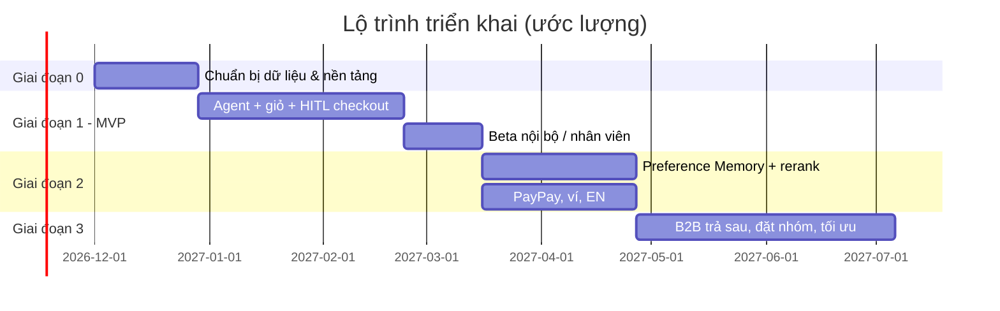

# 12. Rủi ro, bảo mật & lộ trình triển khai

## 12.1 Rủi ro & biện pháp

| # | Rủi ro | Mức | Biện pháp |
|---|---|---|---|
| R1 | **Trừ tiền không có sự đồng ý** (LLM tự thanh toán, bị prompt injection) | Nghiêm trọng | LLM không có tool thanh toán; token chỉ sinh từ `/checkout/confirm` (nút UI + CSRF + Origin + access token); token ký bằng khóa Key Vault, 1 lần, gắn `cart_version`/`checkout_hash`/`total`; Commerce API xác minh lại độc lập |
| R2 | **Gợi ý/thêm món chứa chất gây dị ứng** | Nghiêm trọng (sức khỏe) | Ràng buộc cứng ở 3 lớp: filter Algolia do server ép, hậu kiểm từ DB trong ranker, kiểm tra ở `add_to_cart`/`update_cart` (gồm option thêm dị ứng). Loại món thiếu dữ liệu dị ứng nếu khách có dị ứng nhóm khuyến nghị. Màn hình xác nhận hiển thị lại. Test hồi quy tự động cho mọi thay đổi ranker. Disclaimer về nhiễm chéo (コンタミ) |
| R3 | **Trừ tiền 2 lần** | Cao | Idempotency key FE → PSP → orders/payments UNIQUE; trạng thái `UNKNOWN` + đối soát; khóa giỏ khi thanh toán |
| R4 | **Prompt injection** qua mô tả món/review/tên quán, hoặc qua tin nhắn khách | Cao | Bọc `<untrusted_data>`, loại ký tự vô hình/điều khiển, giới hạn độ dài, lọc mẫu chỉ thị ("ignore previous", "system:"…) khi nhập dữ liệu quán; tool allowlist; kiểm tra output (giá/số tiền trong text LLM phải khớp dữ liệu tool — nếu không, không hiển thị con số đó); bộ test red-team |
| R5 | **LLM bịa giá/thông tin** | Trung bình | UI hiển thị giá/dị ứng/tổng từ dữ liệu có cấu trúc (thẻ món, mini cart, màn hình xác nhận), không từ text LLM; system prompt cấm bịa |
| R6 | **Sai thuế / hóa đơn không hợp lệ** | Cao (pháp lý) | Engine thuế deterministic, unit test với các ca biên (giảm giá phân bổ theo mức thuế, làm tròn 1 lần/mức/hóa đơn); kế toán/thuế vụ duyệt mẫu PDF; số hóa đơn tuần tự; lưu 7 năm |
| R7 | **Rò rỉ dữ liệu cá nhân / vi phạm APPI** | Cao | Tối thiểu dữ liệu gửi Claude API (chỉ họ, ID, nhãn PTTT — không email/điện thoại/số thẻ/token PSP); đồng ý riêng cho dữ liệu nhạy cảm; công bố chuyển dữ liệu ra nước ngoài; quyền xem/sửa/xóa; che PII trong log; mã hóa at-rest (TDE) & in-transit |
| R8 | **Agent hành động vượt quyền** | Cao | Không có tham số user_id; token người dùng/OBO; Commerce API phân quyền lại; rate limit tool call mỗi phiên (ví dụ ≤ 30 tool call/lượt, ≤ 10 thay đổi giỏ/phút) |
| R9 | **Độ trễ / chi phí Claude API** tăng giờ cao điểm | Trung bình | Prompt caching (system + tools tĩnh, dùng chung cho mọi khách), customer_context nạp sẵn, tool call song song, streaming; hạn mức chi phí/ngày theo người dùng; dashboard chi phí/đơn từ `agent_logs`; xem [11](11-cost-estimate.md) |
| R10 | **Claude API lỗi / quá tải / bị giới hạn tốc độ** | Trung bình | `LLMProvider`: timeout mỗi lời gọi (45s) và mỗi lượt (90s), retry có backoff + jitter (tôn trọng `retry-after`), chỉ retry khi chưa stream chữ; thông báo lịch sự + luồng đặt món thường (giỏ vẫn giữ); theo dõi tier rate limit của Sonnet 5.5 trước giờ cao điểm |
| R14 | **Lộ API key Claude** | Cao | Key chỉ ở backend (Key Vault + Managed Identity; `.env` git-ignore khi dev), không log, không gửi frontend; quét secret trong CI; xoay vòng định kỳ và **thu hồi ngay nếu key từng xuất hiện ở chat, ticket, tài liệu**; workspace riêng cho production với giới hạn chi tiêu trên Anthropic Console |
| R15 | **Claude từ chối nhầm (refusal)** | Thấp | Haiku 5.5 không có server-side fallback (chỉ Sonnet/Opus có; code tự bật lại nếu đổi model); xử lý `stop_reason: "refusal"` trước khi đọc nội dung; thông báo lịch sự; theo dõi tỷ lệ trong audit |
| R17 | **Model nhẹ (Haiku) xử lý chưa tốt luồng phức tạp** (đổi ý nhiều lần, đặt nhóm) | Trung bình | Mọi ràng buộc quan trọng do backend ép nên không ảnh hưởng an toàn; tool trả sẵn phương án thay thế; đo bằng evals trước go-live; nếu chưa đạt: chuyển `LLM_MAIN_MODEL` sang `claude-sonnet-5-5` (toàn bộ hoặc A/B) — chi phí tăng ~15× ([11](11-cost-estimate.md)) |
| R16 | **Hành vi thay đổi khi đổi model/effort** | Trung bình | Mọi thay đổi model/effort/prompt chạy bộ evals trong CI; A/B qua cấu hình `LLMProvider`; ghi model vào mỗi dòng `agent_logs` |
| R11 | **Dữ liệu Algolia lệch DB** (giá, tồn, dị ứng) | Trung bình | CDC/sync job + giám sát độ trễ; mọi số liệu quyết định đều đọc lại từ DB |
| R12 | **Khách không tin tưởng AI tự thêm giỏ** | Trung bình | Luôn nói rõ "đã thêm", highlight trong mini cart, dễ hoàn tác; cho phép tắt "tự thêm vào giỏ" trong cài đặt (chỉ gợi ý) |
| R13 | **Tấn công lặp đi lặp lại / lạm dụng coupon qua agent** | Thấp–TB | Coupon do server chọn (`auto`) và kiểm tra điều kiện; LLM không thể tạo mã |

### Kiểm soát bảo mật bổ sung
- **Secrets**: `ANTHROPIC_API_KEY`, khóa ký token, khóa PSP trong Azure Key Vault, đọc qua Managed Identity. Không bao giờ hard-code, không đưa vào frontend, không ghi log.
- **Network**: Agent Service và Commerce API trong VNet; chỉ Gateway public; egress allowlist (Claude API, Algolia, PSP, ACS).
- **Audit**: `agent_logs` append-only + chuỗi băm; dashboard kiểm tra: số confirmation phát hành vs số thanh toán; cảnh báo nếu có `execute_payment` không kèm `confirmation_request_id`.
- **Đánh giá (evals)**: bộ kịch bản offline (≥ 200 hội thoại JA/EN) chấm: tuân thủ dị ứng (phải 100%), đúng khung giờ/địa chỉ, chất lượng gợi ý, giọng văn です/ます, kháng injection. Chạy trong CI trước mỗi thay đổi prompt/tool/model.
- **Pentest** trước go-live, tập trung vào `/checkout/confirm`, SSE, GraphQL (giới hạn độ sâu/độ phức tạp truy vấn, tắt introspection ở production).

## 12.2 Chỉ số đo thành công

| Chỉ số | Mục tiêu MVP |
|---|---|
| Tỷ lệ hội thoại → đơn hàng | ≥ 35% |
| Số lượt chat trung bình đến màn hình xác nhận | ≤ 4 |
| Thời gian từ mở chat → đặt xong (p50) | ≤ 90 giây |
| Vi phạm dị ứng | **0** (chỉ số chặn phát hành) |
| Thanh toán không có confirmation hợp lệ | **0** |
| Tỷ lệ "đổi món" sau gợi ý đầu tiên | ≤ 40% (giảm dần theo thời gian) |
| Điểm đánh giá trung bình sau giao | ≥ 4.2 |
| Chi phí LLM / đơn hàng | theo dõi, đặt ngưỡng cảnh báo |

## 12.3 Lộ trình

### Giai đoạn 0 — Chuẩn bị (≈ 4 tuần)
- Bổ sung dữ liệu: 28 mục dị ứng + `allergen_data_complete` cho toàn bộ menu (làm việc với nhà hàng), `tax_category`, `taste_tags`.
- Bổ sung thuộc tính Algolia, synonyms tiếng Nhật.
- Engine thuế 8%/10% + mẫu hóa đơn 適格請求書 (duyệt bởi kế toán) — có giá trị ngay cả với luồng cũ.
- Idempotency cho luồng thanh toán hiện tại.
- Thiết lập App Registration Entra cho Agent API (scope, OBO).

### Giai đoạn 1 — MVP (≈ 8 tuần + 3 tuần beta)
- Agent Service: `LLMProvider` (Claude Haiku 5.5 cho agent và tác vụ nhẹ — ưu tiên chi phí), agent loop, SSE, 14 tool cho Claude, confirmation token, pipeline payment → order → invoice → email, audit log có token/chi phí, hạn mức theo người dùng.
- Preference **chỉ dạng cấu trúc đơn giản**: dị ứng/chế độ ăn tường minh + lịch sử đơn (món/quán/giờ/địa chỉ hay dùng). Chưa có embedding.
- Rerank đơn giản: Algolia relevance + món đã đặt/đánh giá + ngân sách.
- Thanh toán: thẻ tín dụng đã lưu. Tiếng Nhật.
- UI: chat, thẻ món, mini cart, màn hình xác nhận, link sang luồng thường.
- Email ACS + PDF hóa đơn.
- Feature flag: bật cho nhân viên → 5% khách → 25%.
- Evals + red-team trước mỗi lần mở rộng.

### Giai đoạn 2 — Cá nhân hóa & mở rộng thanh toán (≈ 6 tuần)
- Preference Memory đầy đủ: event log, suy giảm, embedding pgvector, tín hiệu ngầm (bỏ khỏi giỏ), hỏi đánh giá sau giao, trích xuất bằng Haiku.
- Tối ưu chi phí theo số liệu thật: effort sweep (`medium` vs `low`), gọn kết quả tool, Batch API cho tóm tắt review hằng đêm, nút "Đặt lại như lần trước" không cần LLM.
- Màn hình "Sở thích của tôi" (xem/sửa/xóa, xuất dữ liệu) — APPI.
- PayPay + ví điện tử khác, 3-D Secure 2 / redirect flow.
- Tiếng Anh. Khôi phục giỏ/hội thoại bỏ dở + nhắc nhở (push/email, có đồng ý).
- A/B test trọng số rerank.

### Giai đoạn 3 — Mở rộng (≈ 10 tuần)
- Thanh toán trả sau cho doanh nghiệp (掛け払い), hóa đơn gộp theo tháng, 宛名 công ty, phê duyệt nội bộ của doanh nghiệp (người đặt ≠ người duyệt → HITL thứ hai).
- Đặt nhóm (nhiều người, nhiều khẩu phần, chia dị ứng theo từng người).
- Đặt lịch định kỳ ("mỗi thứ 2 giao như thường lệ") — vẫn cần xác nhận mỗi lần hoặc ủy quyền giới hạn có trần tiền (cần đánh giá pháp lý/UX riêng).
- Learning-to-rank từ dữ liệu click/add-to-cart/đánh giá; tối ưu chi phí LLM (đo chất lượng trước khi dùng model nhỏ hơn cho bước phân loại/tóm tắt).
- Voice input, LINE integration (kênh phổ biến ở Nhật) dùng cùng Agent Service.
